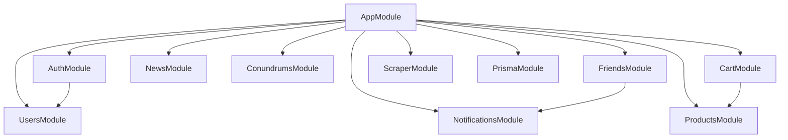

# 📋 Техническое Задание (ТЗ): Миграция PS-Store Backend на NestJS + Prisma + PostgreSQL

> **Роль**: Тимлид / Продакт-менеджер  
> **Цель**: Полная реархитектура legacy Express/MongoDB бэкенда в современный энтерпрайз-стек **NestJS + Prisma + PostgreSQL + WebSockets**.  
> **Исполнитель**: Вы (разработчик, переходящий из Frontend в Fullstack).  
> **Методика**: Самостоятельное написание кода с опорой на данное ТЗ, постепенное усвоение архитектурных паттернов и обучение на собственных ошибках.

---

## 1. Обзор проекта и Анализ Legacy (Что у нас есть)

Текущий бэкенд представляет собой Node.js + Express приложение с MongoDB (Mongoose), Socket.io и скриптами скрапинга на `jsdom`.

### 🚨 Критические уязвимости и Anti-Patterns Legacy-кода:

1. **Безопасность и Авторизация**:
   - ❌ Пароли хранятся в открытом виде (`plain-text`).
   - ❌ В JWT-токен зашивается **весь** объект пользователя (`mongoProfile`), включая нехешированный пароль.
   - ❌ Отсутствие Middleware / Guards для защиты эндпоинтов (любой может дергать эндпоинты).
   - ❌ `res.status(400)` вызывается без `return`, из-за чего выполнение функции продолжается.

2. **Нарушение RESTful API стандартов**:
   - ❌ `POST` используется там, где нужен `GET`: поиск друзей (`/authorization/search`), получение списка товаров/новостей (`/newsAndProducts/listOfNewsOrProducts`), получение страницы товара (`/newsAndProducts/page`), получение головоломок (`/conundrums`).
   - ❌ **Оверлоадинг (Перегрузка)** эндпоинта `PATCH /authorization/:cardId`: один handler выполняет сразу 5 разрозненных бизнес-задач (отправка запроса в друзья, принятие запроса, отклонение запроса, удаление из друзей, обновление профиля) на основе хаотичной проверки структуры полей в `req.body`.
   - ❌ Импорт динамических моделей Mongoose по имени из `req.body.type`: `mongoose.model(req.body.type, schema)`.

3. **Проблемы схемы БД (MongoDB -> PostgreSQL)**:
   - ❌ Хранение связей в виде огромных JSON-массивов внутри документа `User`: `friends: [{...}]`, `favorite`, `cart`, `ownership`, `solved`.
   - ❌ Отсутствие внешних ключей, каскадных удалений и нормализации.

4. **Парсеры и Инициализация**:
   - ❌ Парсинг сторонних сайтов через `jsdom` запускается прямо в `index.js` при старте сервера без обработчиков ошибок и фоновых задач (Cron/Queue).

---

## 2. Архитектура Нового Проекта (NestJS + Prisma + PostgreSQL)

### 🏗 Модульная структура NestJS

Приложение должно быть разбито на изолированные NestJS-модули:



1. **`PrismaModule`**: Глобальный модуль базы данных (PrismaService).
2. **`AuthModule`**: Регистрация, авторизация (JWT + Passport + bcrypt), AuthGuard, `@CurrentUser()` декоратор.
3. **`UsersModule`**: Управление профилем, просмотр пользователей, поиск, баланс кошелька.
4. **`FriendsModule`**: Логика заявок в друзья (отправка, принятие, отклонение, удаление).
5. **`ProductsModule`**: Каталог товаров (игры, консоли, аксессуары), фильтрация, поиск, пагинация, детали товара.
6. **`NewsModule`**: Новости по категориям (PS5, PS4, PS VR2, PS Plus, PS Store).
7. **`ConundrumsModule`**: Головоломки, загадки, проверка ответов и сохранение прогресса.
8. **`CartModule`**: Корзина пользователя и оформление покупок (списание из `wallet`, добавление в `ownership`).
9. **`NotificationsModule`**: WebSocket Gateway (Socket.io) для реалтайм ивентов и уведомлений.
10. **`ScraperModule`**: Cron-задачи (`@nestjs/schedule`) для авто-обновления каталога новостей и товаров.

---

## 3. Схема Базы Данных (Prisma Schema)

В реляционной PostgreSQL данные должны быть строго нормализованы.Никаких сырых массивов объектов в поле `User`!

### Draft `prisma/schema.prisma`

```prisma
datasource db {
  provider = "postgresql"
  url      = env("DATABASE_URL")
}

generator client {
  provider = "prisma-client-js"
}

enum FriendshipStatus {
  PENDING
  ACCEPTED
  REJECTED
}

enum ProductCategory {
  GAMES
  CONSOLES
  ACCESSORIES
}

enum NewsCategory {
  PS5
  PS_VR2
  PS4
  PS_STORE
  PS_PLUS
}

model User {
  id          String   @id @default(uuid())
  userName    String   @unique
  password    String   // Хеш пароля (bcrypt)
  country     String
  avatar      String
  birthDay    String
  wallet      Float    @default(0.0)
  isOnline    Boolean  @default(false)
  createdAt   DateTime @default(now())
  updatedAt   DateTime @updatedAt

  // Связи (Relations)
  sentFriendRequests     Friendship[] @relation("SentRequests")
  receivedFriendRequests Friendship[] @relation("ReceivedRequests")
  cartItems              CartItem[]
  ownerships             UserOwnership[]
  favorites              Favorite[]
  solvedConundrums       UserConundrumSolved[]

  @@map("users")
}

model Friendship {
  id          String           @id @default(uuid())
  senderId    String
  sender      User             @relation("SentRequests", fields: [senderId], references: [id], onDelete: Cascade)
  receiverId  String
  receiver    User             @relation("ReceivedRequests", fields: [receiverId], references: [id], onDelete: Cascade)
  status      FriendshipStatus @default(PENDING)
  createdAt   DateTime         @default(now())
  updatedAt   DateTime         @updatedAt

  @@unique([senderId, receiverId])
  @@map("friendships")
}

model Product {
  id             String          @id @default(uuid())
  title          String          @unique
  img            String
  page           String
  cover          String?
  backgroundImg  String?
  developer      String?
  rating         Float?          @default(0.0)
  price          Float           @default(0.0)
  genre          String?
  platform       String?
  category       ProductCategory @default(GAMES)
  compatibility  String[]        // Prisma поддерживает массивы строк для PostgreSQL
  additionalInfo Json?           // Для специфичных метаданных
  createdAt      DateTime        @default(now())

  cartItems      CartItem[]
  ownerships     UserOwnership[]
  favorites      Favorite[]

  @@map("products")
}

model News {
  id        String       @id @default(uuid())
  title     String       @unique
  img       String
  page      String
  price     Float?       @default(0.0)
  category  NewsCategory
  content   Json?        // Для хранения спарсенных блоков статьи
  createdAt DateTime     @default(now())

  @@map("news")
}

model CartItem {
  id        String   @id @default(uuid())
  userId    String
  user      User     @relation(fields: [userId], references: [id], onDelete: Cascade)
  productId String
  product   Product  @relation(fields: [productId], references: [id], onDelete: Cascade)
  quantity  Int      @default(1)
  createdAt DateTime @default(now())

  @@unique([userId, productId])
  @@map("cart_items")
}

model UserOwnership {
  id        String   @id @default(uuid())
  userId    String
  user      User     @relation(fields: [userId], references: [id], onDelete: Cascade)
  productId String
  product   Product  @relation(fields: [productId], references: [id], onDelete: Cascade)
  boughtAt  DateTime @default(now())

  @@unique([userId, productId])
  @@map("user_ownerships")
}

model Favorite {
  id        String   @id @default(uuid())
  userId    String
  user      User     @relation(fields: [userId], references: [id], onDelete: Cascade)
  productId String
  product   Product  @relation(fields: [productId], references: [id], onDelete: Cascade)

  @@unique([userId, productId])
  @@map("favorites")
}

model Conundrum {
  id          String   @id @default(uuid())
  title       String
  category    String   // riddles / schoolPrg
  subcategory String?  // easy, kids, math, word, hard
  question    String
  answer      String
  points      Int      @default(10)

  userSolved  UserConundrumSolved[]

  @@map("conundrums")
}

model UserConundrumSolved {
  id          String    @id @default(uuid())
  userId      String
  user        User      @relation(fields: [userId], references: [id], onDelete: Cascade)
  conundrumId String
  conundrum   Conundrum @relation(fields: [conundrumId], references: [id], onDelete: Cascade)
  solvedAt    DateTime  @default(now())

  @@unique([userId, conundrumId])
  @@map("user_conundrum_solved")
}
```

---

## 4. Спецификация REST API и Изменения Контрактов

В процессе переписывания бэкенда нужно откорректировать эндпоинты под стандарт REST. (Фронтенд в будущем адаптируется под эти правильные руты).

### 🔑 1. Авторизация (`/auth`)
- `POST /auth/register` — Регистрация нового пользователя (`CreateUserDto`). Хеширование пароля через `bcrypt`.
- `POST /auth/login` — Логин (`LoginDto`). Возвращает `{ accessToken, refreshToken, user }` (пароль исключен из объекта!).
- `POST /auth/refresh` — Обновление JWT токена.

### 👤 2. Пользователи (`/users`)
- `GET /users/me` — Получение профиля текущего авторизованного пользователя (Bearer Token).
- `GET /users/search?name=...` — Поиск пользователя по имени (Вместо `POST /authorization/search`).
- `GET /users/:id` — Профиль пользователя по ID.
- `PATCH /users/me` — Обновление личных данных профиля (аватар, страна).

### 👥 3. Друзья (`/friends`)
*Вместо монструозного `PATCH /authorization/:cardId` выносим чистовые эндпоинты:*
- `POST /friends/request/:targetUserId` — Отправить заявку в друзья.
- `PATCH /friends/request/:requestId/accept` — Принять заявку.
- `PATCH /friends/request/:requestId/reject` — Отклонить заявку.
- `DELETE /friends/:friendId` — Удалить пользователя из друзей.
- `GET /friends` — Список друзей текущего пользователя.
- `GET /friends/requests` — Список входящих/исходящих заявок.

### 🎮 4. Продукты и Новости (`/products` & `/news`)
*Вместо `POST /newsAndProducts/listOfNewsOrProducts` с невнятным body:*
- `GET /products?category=GAMES&genre=Action&minPrice=10&maxPrice=50&page=1&limit=20` — Четкие Query параметры.
- `GET /products/:id` — Детальная страница товара.
- `GET /news?category=PS5&page=1` — Список новостей по категориям.
- `GET /news/:id` — Детальная страница новости.

### 🛒 5. Корзина и Покупки (`/cart` & `/checkout`)
- `GET /cart` — Получить корзину пользователя.
- `POST /cart/items` — Добавить товар в корзину.
- `DELETE /cart/items/:productId` — Удалить товар из корзины.
- `POST /checkout` — Купить товары в корзине (проверка `wallet >= total`, списание средств, очистка корзины, добавление в `UserOwnership`).

### 🧩 6. Головоломки (`/conundrums`)
- `GET /conundrums?type=riddles&subcategory=math` — Список загадок.
- `POST /conundrums/:id/solve` — Отправить ответ на загадку (проверка ответа, начисление баллов/пополнение `wallet`).

---

## 5. WebSockets & Уведомления (Notifications)

Используется `@nestjs/websockets` с адаптером Socket.io.

### Требования к Gateway (`NotificationsGateway`):
1. **Аутентификация**: Подключение по WSS с проверкой JWT в handshake (`auth.token`).
2. **Комнаты (Rooms)**: При успешном подключении пользователь автоматически входит в room `user_${userId}`.
3. **Ивенты**:
   - `notification`: Общее уведомление (`{ title, message, type, timestamp }`).
   - `friend_request`: Уведомление о новой заявке в друзья.
   - `friend_accept`: Уведомление об одобрении заявки.
   - `friend_reject`: Уведомление об отклонении.
   - `friend_delete`: Уведомление об удалении из друзей.

---

## 6. Пошаговый План Реализации (Roadmap для Вас)

Вы должны двигаться по итерациям (Milestones). Не пытайтесь написать все за один день.

### Milestone 1: Инициализация и Инфраструктура 🚀
1. Создать новый NestJS проект: `nest new ps-store-backend`.
2. Поднять PostgreSQL в Docker (`docker-compose.yml`).
3. Установить и настроить Prisma ORM (`npx prisma init`).
4. Скопировать предоставленную выше схему в `prisma/schema.prisma` и выполнить первую миграцию: `npx prisma migrate dev --name init`.

### Milestone 2: AuthModule & UsersModule 🔑
1. Установить `@nestjs/jwt`, `@nestjs/passport`, `passport-jwt`, `bcrypt`, `class-validator`, `class-transformer`.
2. Написать `CreateUserDto` и `LoginDto` с валидацией.
3. Реализовать `AuthService` (хеширование через `bcrypt.hash`, сравнение через `bcrypt.compare`, генерация JWT).
4. Написать `JwtStrategy` и `JwtAuthGuard`.
5. Создать кастомный декоратор `@CurrentUser()`.

### Milestone 3: ProductsModule & NewsModule + Prisma Seed 📦
1. Реализовать CRUD / Read методы в `ProductsService` и `NewsService` с DTO фильтрации.
2. Написать скрипт сидинга `prisma/seed.ts` (заполнить базовыми играми и новостями из legacy или сгенерировать фейковые данные для теста).

### Milestone 4: FriendsModule (Связи в PostgreSQL) 🤝
1. Реализовать отправку заявок в друзья через таблицу `Friendship`.
2. Реализовать методы подтверждения/отклонения/удаления.
3. Покрыть бизнес-правила (нельзя добавить самого себя, нельзя отправить дубликат заявки).

### Milestone 5: CartModule, Wallet & Checkout 🛒
1. Реализовать добавление/удаление из корзины.
2. Написать сервис оплаты: транзакция в Prisma (`prisma.$transaction`), проверяющая баланс пользователя и создающая записи в `UserOwnership`.

### Milestone 6: NotificationsModule (WebSockets) 🔔
1. Создать Gateway с помощью `@WebSocketGateway()`.
2. Реализовать JWT guard для сокетов.
3. Интегрировать отправку событий из `FriendsService` в `NotificationsGateway`.

### Milestone 7: ScraperModule (Фоновые задачи) 🕷
1. Подключить `@nestjs/schedule`.
2. Перенести JSDOM-парсеры в Cron-сервис (`@Cron('0 0 * * *')`).

---

## 7. Памятка для обучения на ошибках (Checklist перед кодом)

> 💡 **Главный принцип**: Если что-то не работает — не гадайте, читайте логи ошибки и стектрейс.

- [ ] **DTO**: Никакого прямого `req.body`. Всегда используйте DTO класс с декораторами `class-validator` (`@IsString()`, `@IsNotEmpty()`, `@IsEmail()` и т.д.).
- [ ] **Global Validation Pipe**: В `main.ts` обязательно включите `app.useGlobalPipes(new ValidationPipe({ whitelist: true }))`.
- [ ] **Prisma Service**: Никогда не делайте сырых SQL-запросов, если можно сделать через Prisma API.
- [ ] **Пароли**: Пароли никогда не должны возвращаться из API в JSON ответах. Пользуйтесь `select` в Prisma или `@Exclude()` из `class-transformer`.
- [ ] **HTTP Статусы**: `200 OK` для чтения/обновления, `201 Created` для создания, `400 Bad Request` для ошибок валидации, `401 Unauthorized` для неверного логина/токена, `404 Not Found` если ресурс не найден.

Удачи в разработке! По шагам разбирайте каждый Milestone, и вы превратитесь из чистокровного фронтендера в сильного фуллстек-разработчика! 🚀
